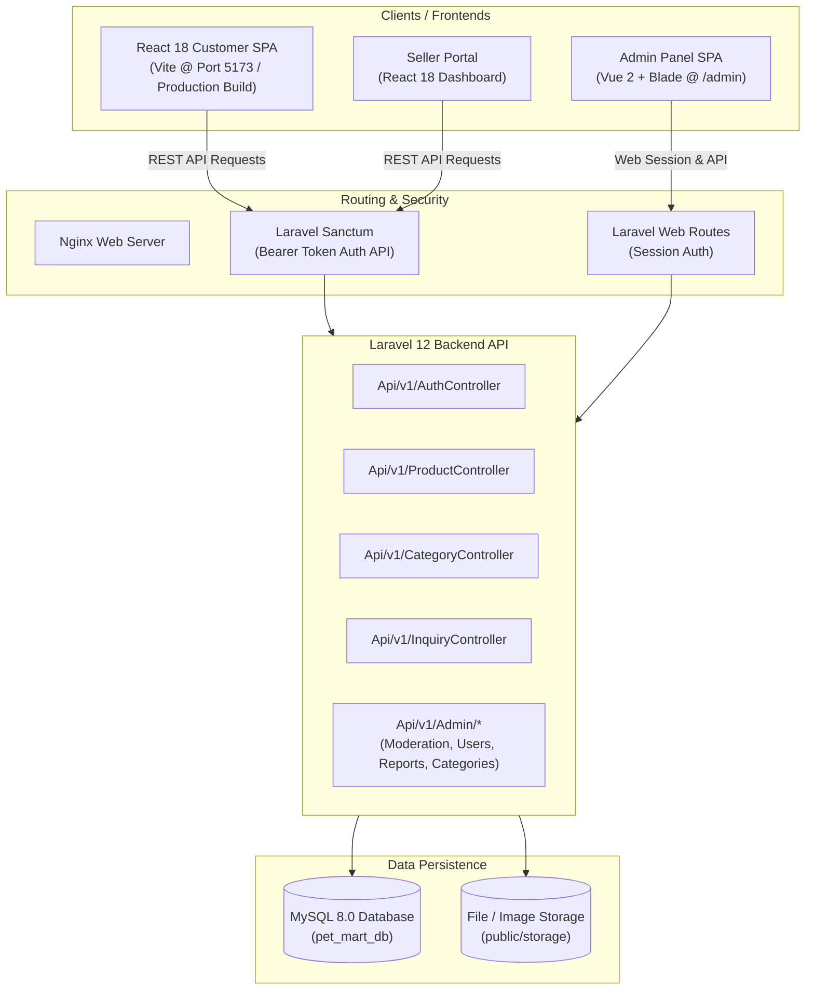

# 🐾 PetMart — Pet & Pet Supplies Marketplace

[](https://laravel.com)
[](https://php.net)
[](https://react.dev)
[](https://vitejs.dev)
[](https://vuejs.org)
[](https://www.mysql.com)
[](https://www.docker.com)
[](LICENSE)

**PetMart** is a comprehensive, full-stack pet marketplace and classifieds platform designed for buying, selling, adopting, and rehoming pets, as well as trading pet food, accessories, and supplies across Bangladesh.

It features a modern dual-frontend architecture:
1. **Customer & Seller Marketplace (React 18 + Vite SPA)**: A high-performance, mobile-responsive portal for customers to search, filter by dynamic attributes, chat with sellers, bookmark listings, and post advertisements.
2. **Admin Moderation & Control Panel (Laravel + Vue 2 SPA)**: An administrative suite with listing moderation queues, seller verification badges, category dynamic attributes configuration, user management, and real-time analytics.

---

## 📑 Table of Contents

- [Key Features](#-key-features)
  - [Marketplace & Buyer Experience](#1-marketplace--buyer-experience)
  - [Seller Experience](#2-seller-experience)
  - [Admin Moderation & Governance](#3-admin-moderation--governance)
- [System Architecture](#-system-architecture)
- [Tech Stack](#-tech-stack)
- [Directory Structure](#-directory-structure)
- [Database Schema & Data Models](#-database-schema--data-models)
- [REST API Endpoints Overview](#-rest-api-endpoints-overview)
- [Installation & Local Setup](#-installation--local-setup)
  - [Option A: Local Development Setup](#option-a-local-development-setup)
  - [Option B: Docker Compose Setup](#option-b-docker-compose-setup)
- [Default Demo Credentials](#-default-demo-credentials)
- [Environment Variables Guide](#-environment-variables-guide)
- [Contributing](#-contributing)
- [License](#-license)

---

## ✨ Key Features

### 1. Marketplace & Buyer Experience
- **Hierarchical Category Navigation**: Pets & Animals (Dogs, Cats, Birds, Fish & Aquatics) and Pet Supplies & Accessories (Food, Cages, Toys, Healthcare).
- **Dynamic Attribute Filtering (EAV Engine)**: Search by breed (Persian, Siberian Husky, etc.), age, gender, and vaccination status without hardcoded schema constraints.
- **Bangladesh Geolocation Engine**: Filter listings hierarchically by Division (e.g., Dhaka, Chittagong, Sylhet, Rajshahi), District (Dhaka City, Gazipur), and Area (Dhanmondi, Uttara, Gulshan, Mirpur) with dual English and Bangla name support.
- **Listing Types Supported**:
  - `sell`: Direct sale
  - `adopt`: Free pet adoption
  - `lost`: Missing pet reports
  - `found`: Found pet reports
  - `stud_service`: Breeding services
- **Multi-Factor Search & Sorting**: Price range, keyword query, latest listings, price low-to-high, price high-to-low, and popularity/views.
- **In-App Messaging / Inquiries**: Direct chat threads between buyers and sellers with unread state tracking.
- **Wishlist & Saved Items**: Save favorite pets and accessories for quick access.
- **Ratings & Reviews**: 1-5 star review system for verified buyer-seller transactions.
- **Listing Abuse Reporting**: Flag spam, illegal animal trade, or fraudulent listings directly to moderators.

### 2. Seller Experience
- **Rich Listing Creator**: Multi-image photo upload, category-dependent dynamic attribute inputs, address selector, price negotiator flag, and condition selector (`new` / `used`).
- **Seller Dashboard**: Real-time management of active listings, pending moderation submissions, and sold listings.
- **One-Click Sold Toggle**: Quickly mark sold pets/items to update marketplace stock.
- **Verified Seller Status**: Verified seller trust badge displayed on seller profiles and product pages.

### 3. Admin Moderation & Governance
- **Interactive Dashboard & Analytics**:
  - Visual metrics powered by ApexCharts.
  - Active, Pending, Sold, and Rejected listing statistics.
  - Category distribution breakdowns and recent marketplace activities.
- **Moderation Approval Queue**:
  - Review submitted listings before they appear on the public marketplace.
  - One-click listing approval.
  - Rejection with mandatory audit trail reason logged in `admin_moderation_logs`.
- **Dynamic Category & Spec Builder**:
  - Add root categories and subcategories with custom icons and sort order.
  - Attach custom dynamic attributes (`text`, `number`, `select`, `boolean`) to any category.
- **User & Seller Verification Management**:
  - Review registered accounts.
  - Toggle `is_verified` seller badges.
  - Activate or deactivate suspended user accounts.
- **Abuse Reports Queue**: Review buyer-flagged listings, mark as resolved, or dismiss reports.
- **Banner Management**: Manage homepage promotional sliders, links, and display order.
- **RBAC (Role-Based Access Control)**: Manage administrative roles, system modules, and fine-grained permissions.

---

## 🏛 System Architecture



---

## 💻 Tech Stack

### Backend
- **Framework**: [Laravel 12.x](https://laravel.com)
- **Language**: PHP 8.2+ / 8.3
- **Authentication**:
  - Web: Laravel Session Auth (Admin portal)
  - API: [Laravel Sanctum](https://laravel.com/docs/sanctum) (Personal Access Bearer Tokens)
- **Database**: MySQL 8.0 with Eloquent ORM, Foreign Key constraints, and Soft Deletes
- **Utilities**: `maatwebsite/excel`, `mpdf/mpdf`, `simplesoftwareio/simple-qrcode`, `brian2694/laravel-toastr`

### Customer Frontend (`/frontend`)
- **Library**: [React 18](https://react.dev)
- **Build Tool**: [Vite 6](https://vitejs.dev)
- **Routing**: [React Router DOM v6](https://reactrouter.com)
- **Icons**: [Lucide React](https://lucide.dev)
- **HTTP Client**: Axios with Bearer token request interceptor

### Admin Panel (`/resources/js`)
- **Framework**: [Vue.js 2.6](https://v2.vuejs.org) & [Vuex](https://vuex.vuejs.org)
- **Routing**: Vue Router 3.x
- **Build Tool**: Laravel Mix 6 / Webpack 5
- **Charts**: ApexCharts (`vue-apexcharts`)
- **Notifications**: SweetAlert2, Toastr

### Infrastructure & DevOps
- **Docker**: Multi-stage production `Dockerfile` (Node 20 -> Composer 2.7 -> PHP 8.3-FPM Alpine)
- **Container Orchestration**: `docker-compose.yml` (App, MySQL 8, phpMyAdmin)
- **Process Manager**: Supervisor (managing PHP-FPM and Nginx inside container)

---

## 📁 Directory Structure

```plaintext
pet-mart/
├── app/
│   ├── Http/
│   │   ├── Controllers/
│   │   │   ├── Api/v1/              # Public & Customer API Controllers
│   │   │   │   ├── Admin/           # Admin Moderation, Category, User, Report Controllers
│   │   │   │   ├── AuthController.php
│   │   │   │   ├── CategoryController.php
│   │   │   │   ├── InquiryController.php
│   │   │   │   ├── LocationController.php
│   │   │   │   ├── ProductController.php
│   │   │   │   ├── ProductReportController.php
│   │   │   │   ├── ReviewController.php
│   │   │   │   └── WishlistController.php
│   │   │   └── AuthController.php   # Admin Web Session Controller
│   │   ├── Middleware/              # Admin and API Protection Middlewares
│   │   ├── Requests/                # Form Request Validation Rules
│   │   └── Resources/               # API JsonResources (Product, User, Category, etc.)
│   └── Models/                      # Eloquent Data Models
│       ├── AdminModerationLog.php
│       ├── Banner.php
│       ├── Category.php
│       ├── CategoryAttribute.php    # EAV Dynamic specs for categories
│       ├── Inquiry.php              # Chat messages
│       ├── Location.php             # Division, District, Area hierarchy
│       ├── Product.php              # Pet and accessory listings
│       ├── ProductAttribute.php     # Dynamic spec values per listing
│       ├── ProductImage.php
│       ├── ProductReport.php
│       ├── Review.php
│       ├── User.php                 # Admin (1), Seller (2), Buyer (3)
│       └── Wishlist.php
├── database/
│   ├── migrations/                  # Schema definition migrations
│   └── seeders/                     # Seeders with realistic demo data
│       ├── AdminUserSeeder.php      # Default Admin, Seller, Buyer users
│       ├── CategorySeeder.php       # Pet categories & dynamic attributes
│       ├── LocationSeeder.php       # Bangladesh divisions, districts & areas
│       ├── ProductSeeder.php        # Initial pet listings
│       └── DatabaseSeeder.php
├── docker/                          # Nginx, supervisor, and entrypoint scripts
│   ├── default.conf
│   ├── nginx.conf
│   ├── startup.sh                   # Auto-migrates and seeds DB on boot
│   └── supervisord.conf
├── frontend/                        # Customer React 18 + Vite SPA
│   ├── src/
│   │   ├── components/              # Navbar, Footer, ProductCard, VerifiedBadge
│   │   ├── context/                 # AuthContext
│   │   ├── pages/                   # Home, Browse, Detail, CreateListing, Dashboard, etc.
│   │   └── services/api.js          # Axios API client configured for Sanctum
│   ├── index.html
│   ├── package.json
│   └── vite.config.js
├── resources/
│   ├── js/                          # Admin Panel Vue 2 SPA source files
│   │   ├── routes/index.js          # Admin route map
│   │   ├── store/                   # Vuex state modules
│   │   └── views/marketplace/       # Moderation, Category, User, Banner views
│   └── views/backend/               # Blade templates serving the Admin SPA
├── routes/
│   ├── api.php                      # Version 1 REST API route definitions
│   └── web.php                      # Admin portal web routes
├── docker-compose.yml
├── Dockerfile
├── package.json                     # Laravel Mix dependencies
└── composer.json                    # PHP dependencies
```

---

## 🗄 Database Schema & Data Models

| Table Name | Primary Purpose |
| :--- | :--- |
| `users` | User credentials, roles, account types (`1=Admin`, `2=Seller`, `3=Buyer`), phone verification, and verified seller badge. |
| `products` | Core listing records: title, price, negotiable flag, listing type (`sell`, `adopt`, `lost`, `found`, `stud_service`), condition (`new`, `used`), moderation status (`pending`, `active`, `sold`, `rejected`), view count. |
| `product_images` | Multi-image support with `is_primary` flag and sort order. |
| `categories` | Hierarchical category tree (Root & Subcategories) with icons and slugs. |
| `category_attributes` | Dynamic schema builder definition: text, number, select options, required flags for specific categories (e.g., Dog Breed, Vaccination). |
| `product_attributes` | EAV value store linking a product to its category attributes. |
| `locations` | Hierarchical Bangladesh location tree: `division` -> `district` -> `area` with English & Bengali (`bn_name`) values. |
| `inquiries` | Direct buyer-to-seller messaging system for listings. |
| `wishlists` | User-saved / bookmarked listings. |
| `reviews` | 1 to 5 star rating and feedback submitted for sellers. |
| `product_reports` | Abuse reports flagged by users with reasons and admin resolution statuses. |
| `admin_moderation_logs` | Audit trail logging which administrator approved or rejected a listing and why. |
| `banners` | Promotional homepage image banners. |

---

## 🔌 REST API Endpoints Overview

All marketplace APIs are prefixed with `/api/v1/`:

### Authentication (`/api/v1/auth`)
| Method | Endpoint | Access | Description |
| :--- | :--- | :--- | :--- |
| `POST` | `/auth/register` | Public | Register customer/seller account with phone & password |
| `POST` | `/auth/login` | Public | Login with phone number & password (returns Sanctum Bearer token) |
| `POST` | `/auth/forgot-password` | Public | Request OTP for password reset (Demo OTP: `123456`) |
| `GET` | `/auth/me` | Protected | Fetch current logged-in user profile & location |
| `POST` | `/auth/logout` | Protected | Revoke active access token |

### Public Marketplace (`/api/v1`)
| Method | Endpoint | Access | Description |
| :--- | :--- | :--- | :--- |
| `GET` | `/categories` | Public | Fetch all categories with subcategories and dynamic attributes |
| `GET` | `/categories/{slug}` | Public | Fetch specific category details |
| `GET` | `/products` | Public | Search & filter listings (queries: `search`, `category_slug`, `division_id`, `district_id`, `min_price`, `max_price`, `listing_type`, `attributes[key]`, `sort`, `page`) |
| `GET` | `/products/{id_or_slug}` | Public | Get listing details & increment view count |
| `GET` | `/locations` | Public | Get hierarchical list of divisions, districts, and areas |

### Protected User & Seller Operations (`/api/v1`)
| Method | Endpoint | Access | Description |
| :--- | :--- | :--- | :--- |
| `POST` | `/products` | Protected | Submit a new listing with photos and specs (enters moderation) |
| `GET` | `/my-listings` | Protected | Retrieve seller's own listings (active, pending, sold) |
| `POST` | `/products/{id}/mark-sold`| Protected | Mark seller's listing as sold |
| `DELETE`| `/products/{id}` | Protected | Delete seller's listing |
| `GET` | `/wishlist` | Protected | Retrieve user's saved wishlist listings |
| `POST` | `/wishlist/toggle` | Protected | Toggle listing in/out of wishlist |
| `GET` | `/inquiries` | Protected | Fetch inquiry chat conversations |
| `POST` | `/inquiries` | Protected | Send message/inquiry to listing seller |
| `POST` | `/reviews` | Protected | Submit rating & review for a completed transaction |
| `POST` | `/products/{id}/report`| Protected | Report a listing for abuse/policy violation |

### Admin Moderation & Management (`/api/v1/admin`)
| Method | Endpoint | Access | Description |
| :--- | :--- | :--- | :--- |
| `GET` | `/admin/dashboard-stats` | Admin | Real-time statistics & ApexCharts series |
| `GET` | `/admin/moderation` | Admin | Fetch listings pending moderation |
| `POST` | `/admin/moderation/{id}/approve` | Admin | Approve listing to make it live |
| `POST` | `/admin/moderation/{id}/reject` | Admin | Reject listing with mandatory reason |
| `GET` | `/admin/categories` | Admin | Category tree with attributes |
| `POST` | `/admin/categories` | Admin | Create category or subcategory |
| `POST` | `/admin/categories/{id}/attributes` | Admin | Add custom dynamic attribute to category |
| `GET` | `/admin/users` | Admin | Paginated user list |
| `POST` | `/admin/users/{id}/toggle-verification` | Admin | Toggle verified seller badge |
| `POST` | `/admin/users/{id}/toggle-status` | Admin | Toggle user active/deactive status |
| `GET` | `/admin/reports` | Admin | Fetch user abuse reports queue |
| `POST` | `/admin/reports/{id}/resolve` | Admin | Mark report as resolved |
| `POST` | `/admin/reports/{id}/dismiss` | Admin | Dismiss report |
| `GET, POST, PUT, DELETE` | `/admin/banners` | Admin | Manage homepage promotional banners |

---

## 🚀 Installation & Local Setup

### System Prerequisites
Ensure your local environment meets the following requirements:
- **PHP**: `^8.2` or `^8.3` (with extensions: `pdo`, `pdo_mysql`, `mbstring`, `gd`, `bcmath`, `xml`, `zip`)
- **Composer**: `^2.x`
- **Node.js**: `^18.x` or `^20.x` & `npm`
- **MySQL**: `^8.0`
- *(Optional)* **Docker & Docker Compose**

---

### Option A: Local Development Setup

#### 1. Clone the Repository
```bash
git clone https://github.com/sebadut-bd/pet-mart.git
cd pet-mart
```

#### 2. Backend Setup (Laravel 12)
```bash
# Install PHP dependencies
composer install

# Configure environment file
cp .env.example .env

# Generate application key
php artisan key:generate
```

Open `.env` and configure your local MySQL credentials:
```env
DB_CONNECTION=mysql
DB_HOST=127.0.0.1
DB_PORT=3306
DB_DATABASE=pet_mart_db
DB_USERNAME=root
DB_PASSWORD=your_password
```

Create the database in MySQL:
```sql
CREATE DATABASE pet_mart_db CHARACTER SET utf8mb4 COLLATE utf8mb4_unicode_ci;
```

Run database migrations and seeders:
```bash
# Migrate tables and populate initial demo data
php artisan migrate --seed

# Create storage symbolic link for uploads
php artisan storage:link
```

#### 3. Build Admin Panel Assets
```bash
# Install root npm dependencies (for Vue 2 Admin Mix)
npm install --legacy-peer-deps

# Build admin assets
npm run dev
# OR for live watch
npm run watch
```

#### 4. Run Laravel Backend Server
```bash
php artisan serve --port=8000
```
Backend API will be accessible at: `http://localhost:8000`  
Admin Login Page: `http://localhost:8000/login`

#### 5. Frontend Setup (React 18 Customer Portal)
Open a new terminal window:
```bash
cd frontend

# Install React dependencies
npm install

# Start Vite development server
npm run dev
```
Marketplace web application will be live at: **`http://localhost:5173`**

---

### Option B: Docker Compose Setup

Run the entire application stack (MySQL 8, phpMyAdmin, Laravel backend + Admin) with a single command:

```bash
# Build and start all containers in detached mode
docker-compose up -d --build
```

The containerized setup automatically:
1. Waits for MySQL healthcheck to pass on port `3309`.
2. Runs all database migrations (`php artisan migrate --force`).
3. Executes seeders to populate initial marketplace data (`php artisan db:seed --force`).
4. Caches configuration, routes, and views.
5. Boots Nginx and PHP-FPM using Supervisor.

#### Container Access Endpoints:
- **Application & Admin Panel**: [http://localhost:8080](http://localhost:8080)
- **phpMyAdmin**: [http://localhost:8081](http://localhost:8081) *(User: `root`, Password: `secret`)*
- **MySQL Direct Port**: `localhost:3309`

To run the React Customer Frontend alongside Docker:
```bash
cd frontend
npm install
npm run dev
```
*(Ensure `frontend/.env` points `VITE_API_BASE_URL=http://localhost:8080/api/v1`)*

To stop all containers:
```bash
docker-compose down
```

---

## 🔑 Default Demo Credentials

The database seeder (`php artisan db:seed`) automatically creates the following accounts for testing:

| Role | Email / Phone | Password | Access Level |
| :--- | :--- | :--- | :--- |
| **Super Admin** | `admin@petmart.com`<br>`+8801700000000` | `password123` | Full access to Admin Panel (`/admin`) & API |
| **Verified Seller** | `seller@petmart.com`<br>`+8801711111111` | `password123` | Seller Dashboard, Post Listings, Verified Badge |
| **Buyer / Customer** | `buyer@petmart.com`<br>`+8801722222222` | `password123` | Browse, Inquiries, Wishlist, Reviews |

> **Note**: Admin login via web session is available at `/login`. Seller and Buyer accounts authenticate via the React Frontend or REST API `/api/v1/auth/login`.

---

## ⚙️ Environment Variables Guide

Key `.env` options for **PetMart**:

```env
# Application Details
APP_NAME=PetMart
APP_ENV=local
APP_KEY=base64:...
APP_DEBUG=true
APP_URL=http://localhost:8000

# Database Configuration
DB_CONNECTION=mysql
DB_HOST=127.0.0.1
DB_PORT=3306
DB_DATABASE=pet_mart_db
DB_USERNAME=root
DB_PASSWORD=secret

# Session & Storage
SESSION_DRIVER=file
FILESYSTEM_DISK=public
QUEUE_CONNECTION=sync

# Frontend API Configuration (frontend/.env)
VITE_API_BASE_URL=http://localhost:8000/api/v1
```

---

## 🧪 Testing & Code Quality

Run tests and automated checks:
```bash
# Run PHPUnit tests
php artisan test

# Run code styling check with Laravel Pint
./vendor/bin/pint --test

# Run frontend linting
cd frontend && npm run lint
```

---

## 🤝 Contributing

Contributions make the open-source community a great place to learn, inspire, and create. Any contributions you make are **greatly appreciated**.

1. Fork the Project
2. Create your Feature Branch (`git checkout -b feature/AmazingFeature`)
3. Commit your Changes (`git commit -m 'Add some AmazingFeature'`)
4. Push to the Branch (`git push origin feature/AmazingFeature`)
5. Open a Pull Request

---

## 📄 License

Distributed under the **MIT License**. See `LICENSE` for more information.

---

<p align="center">
  Crafted with ❤️ for pet lovers and breeders.
</p>
# pet-mart
# pet-mart
# pet-mart
